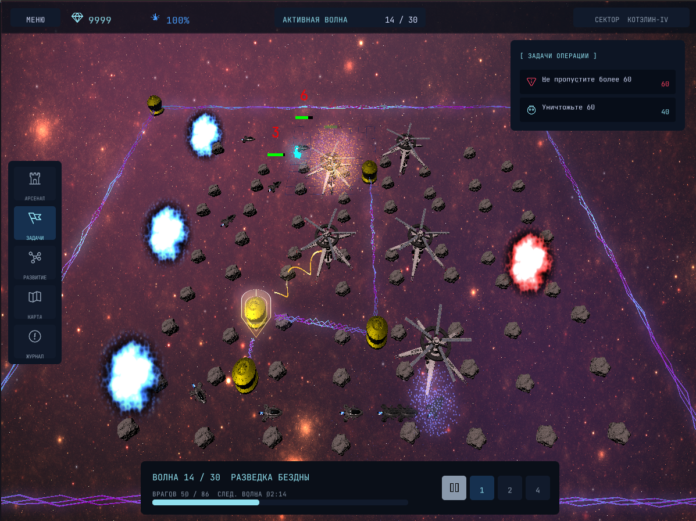
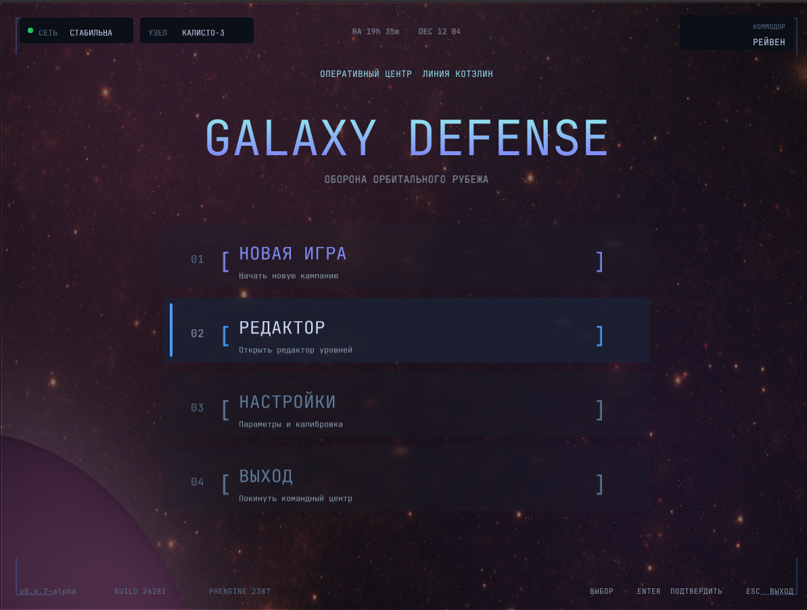

# PHEngine / GalaxyDefense — Build HOWTO

How to build the engine (`PHEngine`), the game (`GalaxyDefense`), and the test
scene (`EngineTest`) on **Linux** and **Windows**.

The build is CMake-based and the CMake project lives in [`root/`](root/).
All third-party libraries are pulled in as **git submodules** under
`root/PHEngine/submodules/` and **built from source** together with the engine —
nothing is shipped prebuilt and nothing needs to be installed separately
(apart from the system packages listed below).

| Library | Submodule |
|---|---|
| Assimp | `assimp` |
| Bullet3 (double precision) | `bullet3` |
| GLEW | `glew` (glew-cmake) |
| GLFW | `glfw` |
| GLM | `glm` |
| FreeType | `freetype` |
| nlohmann/json | `nlohmann_json` |
| Lua 5.4 | `lua` |
| stb | `stb` |
| libsndfile + ogg / vorbis / flac / opus | `libsndfile`, `ogg`, `vorbis`, `flac`, `opus` |
| OpenAL Soft | `openal` |

Post-build steps automatically put next to each executable:

- the game resources (shaders / models / textures / lua / config) → `<output>/res`;
- the only shared libraries of the project — **GLEW** and **OpenAL**.

Everything else is linked statically.

---

## 1. Prerequisites

Common to both platforms:

- **Git** (to fetch the submodules)
- **CMake ≥ 3.21** (needed for `CMakePresets.json`; a plain `cmake -B … -S root`
  configure works with ≥ 3.16.3)
- A **C/C++20** compiler: GCC 13+, Clang, or MSVC (the Windows preset targets
  Visual Studio 2026)
- An **OpenGL**-capable GPU + drivers

---

## 2. Get the sources

Clone together with all submodules:

```bash
git clone --recurse-submodules <repo-url>
```

Or, in an existing checkout:

```bash
git submodule update --init --recursive
```

> The first build compiles all dependencies (Assimp, Bullet, OpenAL, …) and
> takes noticeably longer than subsequent incremental builds.

---

## 3. Build on Linux

### 3.1 Install system packages

Only the system-level pieces are needed: compiler, OpenGL, X11 / Wayland headers
for GLFW, and audio backends for OpenAL Soft.

```bash
sudo apt update
sudo apt install -y \
    build-essential cmake git \
    libgl1-mesa-dev libglu1-mesa-dev \
    libx11-dev libxrandr-dev libxinerama-dev libxcursor-dev libxi-dev \
    libwayland-dev libxkbcommon-dev wayland-protocols \
    libasound2-dev libpulse-dev
```

> - GLFW builds both X11 and Wayland backends by default. If you don't need
>   Wayland, configure with `-DGLFW_BUILD_WAYLAND=OFF` and skip the Wayland
>   packages.
> - Without `libasound2-dev` / `libpulse-dev` OpenAL Soft still builds, but
>   without a real audio backend — the game will run with no sound.
> - If you build with `ENABLE_LIBUNWIND=ON`, also install `libunwind-dev`.

### 3.2 Configure & build (presets)

Presets are defined in `root/CMakePresets.json`, so run them from `root/`:

```bash
cd root
cmake --preset linux-debug                # or: linux-release
cmake --build --preset linux-debug -j$(nproc)
```

Build trees are created in `build/<preset>/` at the repository root
(e.g. `build/linux-debug/`).

Without presets, from the repository root (equivalent, as used in CI):

```bash
cmake -B build -S root \
    -DCMAKE_BUILD_TYPE=Debug \
    -DBUILD_GALAXY_DEFENSE=ON \
    -DBUILD_ENGINE_TEST=ON

cmake --build build -j$(nproc)
```

### 3.3 Run

From the repository root:

```bash
cd build/linux-debug/GalaxyDefense
./GalaxyDefense
```

The test scene, if built: `build/linux-debug/EngineTest/EngineTest`.

---

## 4. Build on Windows

Use the **x64** architecture. Run the commands in a
*Developer PowerShell / Command Prompt for VS*.

### 4.1 Configure & build (presets, Visual Studio 2026)

Presets are defined in `root/CMakePresets.json`, so run them from `root\`:

```bat
cd root
cmake --preset windows
cmake --build --preset windows-debug
```

Use `windows-release` for a Release build.

The solution is generated in `build\windows\` — you can also open
`build\windows\GalaxyDefenseProject.slnx` in Visual Studio and build from there.

### 4.2 Other Visual Studio versions

The preset is pinned to the `Visual Studio 18 2026` generator. With another
version, configure manually from the repository root:

```bat
cmake -B build -S root -G "Visual Studio 17 2022" -A x64 ^
    -DBUILD_GALAXY_DEFENSE=ON ^
    -DBUILD_ENGINE_TEST=ON

cmake --build build --config Debug
```

`/bigobj`, `/utf-8` and `/MP` are set automatically for MSVC.
`ENABLE_LIBUNWIND` must stay **OFF** on Windows (libunwind is Unix-only).

### 4.3 Run

From the repository root:

```bat
cd build\windows\GalaxyDefense\Debug
GalaxyDefense.exe
```

No manual DLL copying is required: the post-build step places the GLEW and
OpenAL DLLs (built from the submodules) and the `res` folder next to the exe.
The same applies to `EngineTest`.

---

## 5. CMake options reference

| Option | Default | Purpose |
|---|---|---|
| `BUILD_GALAXY_DEFENSE` | ON | Build the game executable |
| `BUILD_ENGINE_TEST` | ON | Build the engine test scene |
| `ENABLE_LIBUNWIND` | OFF | Compile libunwind-backed stack tracing (Linux only) |
| `ENABLE_ASAN` | OFF | Address sanitizer (+ UB sanitizer on GCC/Clang; ASan only on MSVC) |
| `ENABLE_TSAN` | OFF | Thread sanitizer (GCC/Clang only; ignored if ASAN is on) |
| `PROFILER_BUILD` | OFF | Optimized build with debug symbols, for profiling |

The `DEBUG` define is set automatically for the **Debug** configuration — choose
it via `CMAKE_BUILD_TYPE` (Linux) or `--config` / build preset (Windows).

Example — sanitized Linux debug build:

```bash
cd root
cmake --preset linux-debug -DENABLE_ASAN=ON
cmake --build --preset linux-debug -j$(nproc)
```

---

## 6. Screenshots

The project includes reference screenshots for the main game states:

- `Gameplay1` — a representative in-game battle / combat view.
- `MainMenu` — the main menu and navigation screen.

### 6.1 Gameplay1



### 6.2 MainMenu


